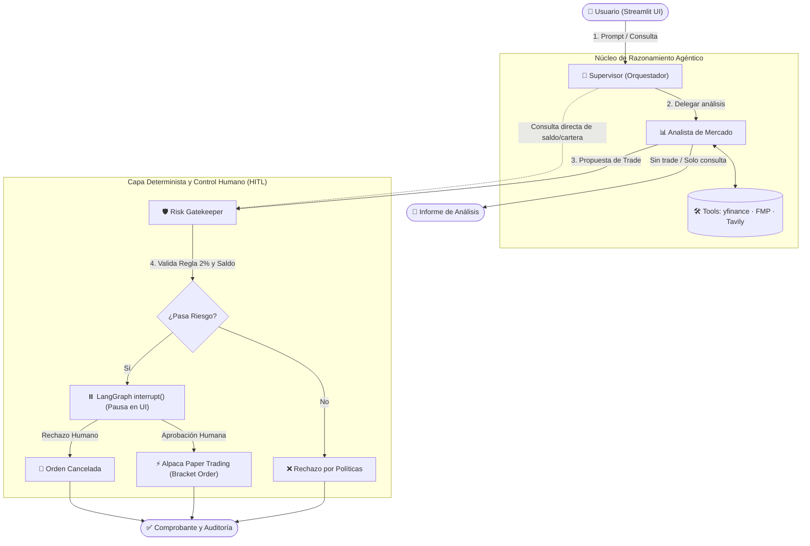

# Asistente Multiagente de Análisis Financiero y Ejecución de Trading (Paper Trading)

Trabajo Final Integrador (TFI) – **Certificación Profesional en AI Agent Developer**  
**Instituto Tecnológico de Buenos Aires (ITBA)** · Cohorte 2026

---

## 1. Nombre del Proyecto
**Sistema Multiagente de Inteligencia Financiera, Control de Riesgo y Ejecución Supervisada (HITL)**

---

## 2. Integrantes
- **Santiago Penas**

---

## 3. Problema
El análisis financiero y la toma de decisiones en los mercados bursátiles exigen procesar de forma simultánea múltiples fuentes heterogéneas: acción del precio, indicadores técnicos, balances fundamentales y catalizadores de noticias de mercado.

La mayoría de las herramientas tradicionales presentan dos extremos deficientes:
1. Interfaces estáticas o algoritmos rígidos que no adaptan su razonamiento al contexto dinámico del inversor.
2. Aplicaciones basadas en LLMs monolíticos que sufren alucinaciones numéricas, carecen de controles deterministas de riesgo y envían órdenes de trading sin validación ni supervisión humana rigurosa.

Este proyecto resuelve este dilema separando de manera estricta el **razonamiento agéntico de mercado** de las **reglas deterministas de protección de capital**, incorporando una compuerta obligatoria de **Human-in-the-Loop (HITL)** antes de cualquier ejecución.

---

## 4. Usuario / Destinatario
Inversores individuales, analistas financieros y operadores cuantitativos que buscan un copiloto inteligente para:
- Investigar dinámicamente oportunidades de inversión en acciones y ETFs del mercado estadounidense (S&P 500 y NASDAQ).
- Contrastar hipótesis técnicas y fundamentales contra procedimientos operativos estándar (SOPs).
- Validar propuestas de operación con cálculo automático de dimensionamiento de posición (*position sizing*) y stop-loss obligatorio.
- Ejecutar órdenes de forma segura en un entorno simulado de corretaje (*Paper Trading*).

---

## 5. Descripción del Sistema y Flujo Principal
El sistema implementa una arquitectura multiagente orquestada mediante un grafo de estados (**LangGraph**):
1. **Entrada del Usuario**: El usuario solicita un análisis o una propuesta de inversión a través de una interfaz interactiva en **Streamlit**.
2. **Orquestación y Delegación**: El **Supervisor** clasifica la consulta y delega la investigación al **Analista de Mercado**.
3. **Investigación Agéntica (Decide → Act → Observe)**: El analista decide dinámicamente si consultar métricas técnicas (`yfinance` + `pandas-ta` en local), ratios fundamentales (`Financial Modeling Prep`) o catalizadores de noticias (`Tavily Search`).
4. **Formulación de Hipótesis y Control de Riesgo**: Si detecta un setup favorable, genera un borrador de propuesta de trade con Stop-Loss y Take-Profit. El **Risk Gatekeeper** evalúa deterministamente la orden contra el saldo de la cuenta de Alpaca y aplica las reglas de gestión de riesgo (riesgo máximo del 2% del capital, exposición máxima del 10%).
5. **Compuerta Human-in-the-Loop (HITL)**: El grafo se pausa obligatoriamente mediante `interrupt()`. La interfaz presenta la orden estructurada al usuario, quien puede **aprobarla, modificar sus parámetros o rechazarla**.
6. **Ejecución Supervisada**: Al recibir la aprobación humana, el **Servicio de Ejecución** envía la orden bracket a la API de **Paper Trading de Alpaca** y retorna el comprobante de auditoría.
7. **Monitoreo y Auditoría Continua**: El usuario puede consultar en todo momento el capital actualizado, posiciones abiertas, órdenes pendientes (con sus niveles de Stop-Loss y Take-Profit activos) y el historial de trades ejecutados, tanto desde el panel lateral como preguntándole en lenguaje natural al asistente en el chat.

---

## 6. Arquitectura del Sistema
El proyecto sigue el patrón de **Sistema Multiagente Acotado [ITBA C12]**:



### Componentes Clave:
- **LLMs y Ruteo**: OpenAI (`gpt-4o` / `gpt-4o-mini`) como motor primario con conmutación por error (*fallback*) automático acotado a Google Gemini (`gemini-2.5-flash`).
- **Skills Reutilizables [C10]**: Paquetes de dominio en `src/skills/`:
  - `technical-setup-strategy`: Procedimiento de evaluación de medias móviles (SMA 20/50/200), RSI y cálculo de distancias por ATR.
  - `risk-management-framework`: Fórmulas matemáticas de dimensionamiento de posición, regla del 2% de riesgo y concentración máxima.
- **Estado y Memoria [C10-C11]**: `SqliteSaver` de LangGraph (`data/checkpoints.db`) para persistencia durable de hilos de sesión y puntos de pausa HITL. Tabla local SQLite para perfiles y preferencias del usuario (`data/user_profile.db`).
- **Integraciones Externas [C9/C13]**:
  - **Alpaca Markets**: Conexión bidireccional a la API de Paper Trading para consulta de saldo, posiciones abiertas, seguimiento de órdenes pendientes (con soporte para horarios fuera de rueda y legs de Stop-Loss/Take-Profit), historial de operaciones y envío de órdenes bracket deterministas.
  - **Financial Modeling Prep (FMP Stable API)**: Extracción en vivo de ratios de solvencia, múltiplos de valuación (P/E, PEG, P/B, Debt-to-Equity), márgenes operativos y netos, crecimiento YoY, beta, precio objetivo de consenso de Wall Street y valor intrínseco por DCF (Discounted Cash Flow).
  - **Tavily AI**: Búsqueda contextual de noticias de mercado y catalizadores depurados para LLMs.
  - **LangSmith**: Telemetría, árboles de ejecución jerárquicos y observabilidad agéntica en tiempo real.

---

## 7. Decisiones Técnicas y Justificación
1. **Multiagente Acotado vs. Monolítico**: Se eligió una arquitectura de 2 agentes especializados (Analista y Riesgo) coordinados por un Supervisor. Esto desacopla el análisis exploratorio de la validación estricta de riesgo, impidiendo que el agente analista ejecute órdenes directamente.
2. **Omisión Justificada de RAG**: Se prescindió de bases de datos vectoriales porque los precios bursátiles, balances y noticias son datos en tiempo real que caducan rápidamente. Las directivas de inversión se estructuran en **Skills Reutilizables** basadas en archivos SOP (`SKILL.md`), garantizando menor costo, latencia y complejidad.
3. **Cálculo Técnico Local**: El análisis técnico se ejecuta 100% en local mediante `pandas-ta` sobre datos de `yfinance`. Esto elimina llamadas de red innecesarias, garantiza 0 ms de latencia adicional y evita costos de APIs externas de indicadores.
4. **Persistencia con SQLite**: Se adoptó `SqliteSaver` local frente a soluciones en memoria (`MemorySaver`) para garantizar que las sesiones y las órdenes pausadas sobrevivan a reinicios de la aplicación.
5. **Compuerta Human-in-the-Loop**: Implementada nativamente con la primitiva `interrupt()` de LangGraph, asegurando que ninguna orden pueda llegar a Alpaca de forma autónoma.

---

## 8. Instalación Paso a Paso

### Prerrequisitos
- Python 3.12 instalado.
- Gestor de paquetes `uv` (recomendado) o `pip`.
- Git.

### Pasos de Instalación con `uv`
1. Clonar el repositorio:
   ```bash
   git clone https://github.com/santipenas/TFI-ITBA-SantiagoPenas.git
   cd TFI-ITBA-SantiagoPenas
   ```
2. Crear el entorno virtual e instalar dependencias fijadas:
   ```bash
   uv sync
   ```
3. Activar el entorno virtual:
   - **Windows (PowerShell)**: `.venv\Scripts\Activate.ps1`
   - **Linux / macOS**: `source .venv/bin/activate`

---

## 9. Configuración y Variables de Entorno
Copiar el archivo de plantilla `.env.example` como `.env`:
```bash
cp .env.example .env
```
Editar `.env` y configurar las credenciales requeridas:
- `OPENAI_API_KEY`: Tu clave de API de OpenAI (Proveedor primario: `gpt-4o`).
- `GEMINI_API_KEY`: Tu clave de API de Google Gemini (Proveedor fallback: `gemini-2.5-flash`).
- `ALPACA_API_KEY`: Tu clave de **Paper Trading** de Alpaca (Sandbox).
- `ALPACA_SECRET_KEY`: Tu clave secreta de **Paper Trading** de Alpaca (Sandbox).
- `FMP_API_KEY`: Tu clave de Financial Modeling Prep (FMP Stable API).
- `TAVILY_API_KEY`: Tu clave de Tavily Search (Noticias en tiempo real).
- `LANGCHAIN_API_KEY` o `LANGSMITH_API_KEY`: Tu clave de LangSmith para telemetría y observabilidad en vivo.
- `LANGCHAIN_PROJECT`: Nombre del proyecto en LangSmith (por defecto `itba-tfi-financial-agent`).

> **IMPORTANTE**: El archivo `.env` está expresamente excluido en `.gitignore` para no exponer secretos en el repositorio.

---

## 10. Ejecución

### Opción A: Ejecución Local con Streamlit (Recomendada)
```bash
uv run streamlit run src/ui/app.py
```
La interfaz estará disponible automáticamente en el navegador web en `http://localhost:8501`.

### Opción B: Ejecución en Contenedor Docker
```bash
docker compose up --build
```

### Opción C: Verificación de Calidad y Linters
```bash
uv run ruff check .
```

---

## 11. Ejemplo de Uso (Recorrido Principal)
1. Abrir la interfaz web en `http://localhost:8501`.
2. En el panel lateral, verificar el saldo sincronizado de la cuenta de Alpaca Paper Trading.
3. En la caja de chat, ingresar la siguiente instrucción:
   > *"Analizá técnica y fundamentalmente a NVDA para una operación swing y decime si ves una oportunidad de compra."*
4. El agente investigará los datos técnicos y fundamentales, mostrando el gráfico interactivo de velas en pantalla.
5. Si las condiciones se cumplen, el sistema presentará la **Tarjeta de Propuesta de Operación**:
   - Ticker: `NVDA`
   - Lado: `BUY`
   - Cantidad sugerida según el 2% de riesgo de la cuenta.
   - Stop-Loss y Take-Profit sugeridos.
6. El usuario hace clic en **"Aprobar Orden"**.
7. El sistema ejecuta la orden bracket en Alpaca Paper Trading y muestra el ID de comprobante oficial emitido por el broker.
8. En el panel lateral, el estado de la cuenta se actualiza en tiempo real: si la rueda está abierta, se incorpora a **Posiciones Abiertas**; si el mercado está cerrado, se visualiza en **Órdenes Pendientes** (`ACCEPTED`) junto con sus precios de SL y TP hasta la apertura de sesión. Todas las órdenes quedan auditadas en el **Historial de Trades**.
9. En cualquier momento posterior, el usuario puede preguntarle al agente por chat: *"¿Qué órdenes tengo pendientes?"* o *"¿Cuál es mi historial de operaciones?"* para obtener un resumen inmediato.

---

## 12. Evaluación y Evidencia de Calidad [C15]
El proyecto cuenta con una batería de pruebas automatizadas y un dataset de evaluación de 12 casos en `evals/`:

- **Pruebas Unitarias e Integración (17/17 tests passing)**:
  ```bash
  uv run pytest
  ```
- **Ejecución del Dataset de Evaluación Cuantitativa**:
  ```bash
  uv run python evals/run_evals.py
  ```

### Resultados Oficiales del Benchmark (12 Casos de Prueba):
- **Tasa de Éxito (Task Success Rate)**: **100.0% (12 / 12 casos PASSED)**
- **Latencia Media por Consulta Completa**: **10.31 segundos**
- **Cumplimiento de Seguridad (Policy Compliance)**: **100%** (Cero órdenes emitidas sin aprobación humana)
- **Trazabilidad en Vivo**: Proyecto registrado en [LangSmith](https://smith.langchain.com/o/default/projects/p/itba-tfi-financial-agent) (`itba-tfi-financial-agent`) con árboles de ejecución de nodos, tiempos por herramienta y conteo de tokens.

El reporte completo generado automáticamente se encuentra en `evals/resultados/evaluation_report.md`.

---

## 13. Limitaciones y Aspectos Fuera de Alcance
- **Entorno Exclusivo de Pruebas**: El sistema no opera con capital real ni brokers en producción; se restringe a la sandbox de Alpaca Paper Trading.
- **Universo de Activos**: Acotado a acciones y ETFs de alta capitalización de los mercados de EE. UU. No opera opciones, futuros ni criptomonedas.
- **Horario de Mercado**: Si se envía una orden de mercado cuando Wall Street está cerrado, la orden quedará registrada por Alpaca como pendiente para la próxima apertura de sesión (`ACCEPTED_FOR_BIDDING`).
- **Sin Asesoramiento Financiero**: Esta aplicación es un proyecto académico de demostración de arquitectura agéntica de IA y no constituye recomendación formal de inversión.
